# Laboratorio8_Thomas_AppToDo_Backend
Este repositorio hace parte del laboratorio 8 de la materia de DOSW, sección BackEnd de la aplicación propuesta AppToDo

| Name                            | GitHub Username                   |
|---------------------------------|-----------------------------------|
| Daniel Santiago Morales Perdomo | `Fukuyaku88`                      |
| Edgar Daniel Ruiz Patiño        | `DaniRuiz11`                      |
| Miguel Ángel Acero Laverde      | `Miguelim101`                     |
| Thomas Sebastian García Gomez   | `thomassebastiangarciagomez-ctrl` |

## Parte 5: Preparar calidad del backend

En esta parte, para poder realizar las pipelines de manera adecuada, primero, verificar que el codigo del backend tenga la calidad suficiente, para esto nos proponen, a parte de tener la dependencia de Jacoco que ya teniamos, incluir una nueva dependencia llamada SpotBugs.

Esta nueva dependencia se encarga de detectar diferentes patrones de fallos, detectando bugs que pueden llegar a ser importantes al momento de construir software. En nuestro caso, detecto 6 bugs de media importancia, sin embargo, es importante correguirlos para poder realizar esta parte del laboratorio de manera correcta.

Gracias a la utilizacion de IA, se detectaron los bugs de manera adecuada y las soluciones a los mismos, donde en 2 casos especificos fueron "falsos positivos", debido a que estos son comportamiento del codigo actual y no deben de ser modificados. Por esta misma razon se agrego el siguiente archivo .xml para evitar algun error en la contruccion del proyecto.

```xml
<FindBugsFilter>
  <Match>
    <Class name="edu.eci.dosw.todo.controller.TaskController"/>
    <Bug pattern="EI_EXPOSE_REP2"/>
  </Match>
  <Match>
    <Class name="edu.eci.dosw.todo.entity.TaskEntity"/>
    <Bug pattern="EI_EXPOSE_REP,EI_EXPOSE_REP2"/>
  </Match>
</FindBugsFilter>
```

Y de igual forma, debido a esta integracion, se debe agregar en la seccion de configuraciones de SpotBugs en el pom.xml el siguiente codigo para que se configure todo de manera adecuada.

```xml
<threshold>Medium</threshold>
<excludeFilterFile>spotbugs-exclude.xml</excludeFilterFile>
```

Al realizar todo este procedimiento, para ejecutar las pruebas y la calidad de las mismas se debe ejecutar en consola dentro de la carpeta de backend el siguiente comando. Esto generara los archivos necesarios para esta parte del laboratorio.

```bash
mvn -B -ntp clean verify
```

Con esto, el archivo se construira de manera adecuada, lo que nos indica que el codigo es el adecuado. Con base en esto, dentro del directorio de docs/ se encuentran el analisis Jacoco y la carpeta de SpotBugs surefire-reports/ que es solicitada en esta parte del laboratorio.

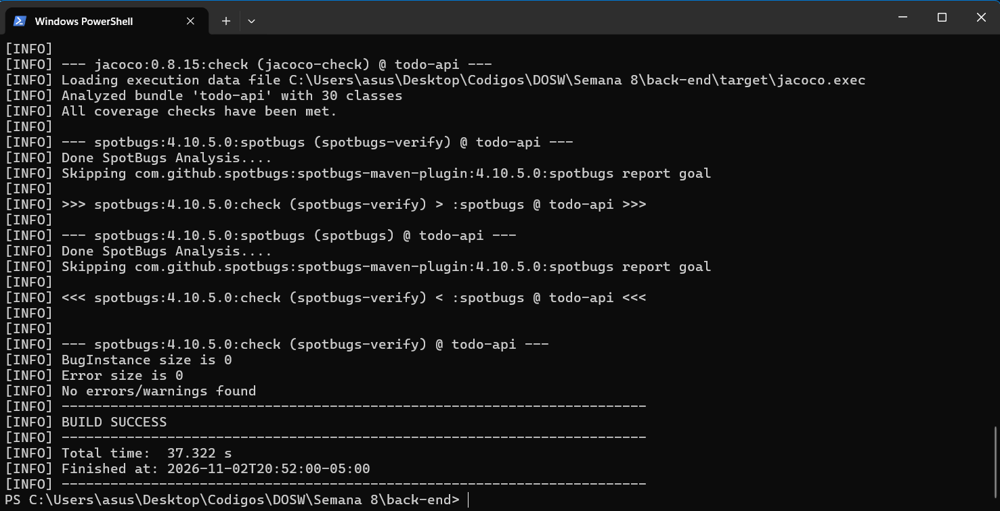

## Parte 7 Etapa A3. Preparar imágenes de Docker (build multietapa):

Se integran los nuevos archivos, estos lo que hacen es construir la imagen en docker, de tal forma que es importante realizar algunos pequeños cambios en el backend, principalmente en utilizar Java 21 y no 17. Esta seria la integracion.

```dockerfile
# Etapa 1: compilación reproducible con Maven
FROM maven:3.9-eclipse-temurin-21 AS build
WORKDIR /workspace
COPY pom.xml ./
RUN mvn -B -ntp dependency:go-offline
COPY src ./src
# Las pruebas ya se ejecutan en CI; no se saltan las validaciones del pipeline.
RUN mvn -B -ntp -DskipTests package

# Etapa 2: runtime compacto (sin Maven ni fuentes)
FROM eclipse-temurin:21-jre
WORKDIR /app
COPY --from=build /workspace/target/*.jar app.jar
EXPOSE 8080
ENTRYPOINT ["java", "-jar", "/app/app.jar"]
```

Tambien se tienen que realizar las integraciones correspondientes en el frontend, en donde lo que se logra observar al ejecutar en consola, dentro de cada uno de los comandos correspondientes, los cuales son

```bash
docker build -t todo-api:local ./backend
docker build -t todo-web:local ./frontend
docker images | grep todo
```

Al ejecutar esto y realizar la consulta de las construicciones hechas en docker, podemos observar que se crearon correctamente en la siguiente imagen.

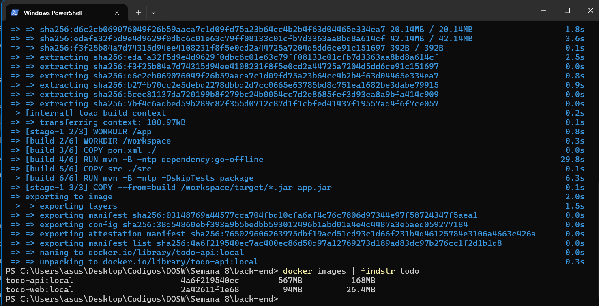

## Parte 8 Etapa A4. Crear el workflow de integración:

En esta seccion, lo que se debe realizar es integrar los workflow en github, el documento propuesto es para un repositorio general, sin emabrgo, desde el principio hemos manejado 2 repositorios separados, de tal forma que para la integracion adecuada entre ambos, tenemos que tener el archivo .yml en cada repositorio con sus correspondientes configuraciones. Teniendo esto en cuenta, en cada repositorio hay que integrar lo siguiente.

En backend:

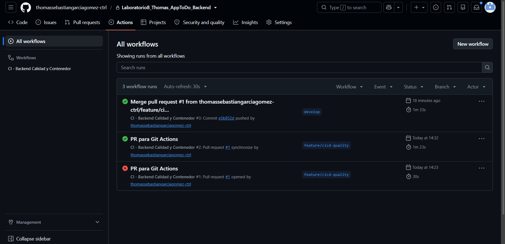

En frontend:

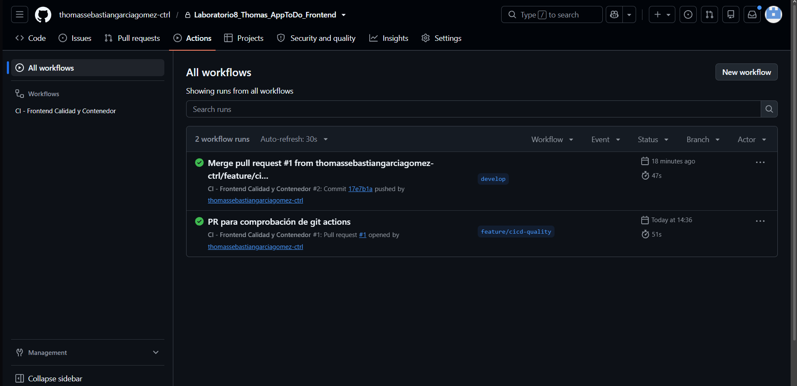

Al crear la nueva rama y subirla a github, cuando realicemos un pull request va a generarse una accion la cual va a comprobar diferentes pruebas para comprobar que efectivamente se puede realizar un merge.

## Parte 9 Etapa B1. Definir el stack productivo del laboratorio:

En esta parte, tenemos que configurar la infraestructura necesaria para subir todo a la nube de manera adecuada, para esto, se nos brindan los codigos necesarios, donde se les realizaron algunas modificaciones, debido a que en el laboratorio se concidera que se maneja 1 solo repositorio, pero aqui manejamos 2.

Al realizar estos cambios, tenemos que ejecutar desde powershell los siguientes comandos para realizar las pruebas necesarias y que se configure todo de manera adecuada (es importante previamente haber realizado el Pull Request a main y verificar que los paquetes se hayan creado correctamente).

```bash
docker compose --env-file .env -f docker-compose.prod.yml config --quiet
docker compose --env-file .env -f docker-compose.prod.yml pull
docker compose --env-file .env -f docker-compose.prod.yml up -d
docker compose --env-file .env -f docker-compose.prod.yml ps
```

Al ejecutar estos comandos en nuestra consola y despues de realizar un par de correcciones necesarias, la siguiente imagen es el resultado que debe arrojar los mismos.

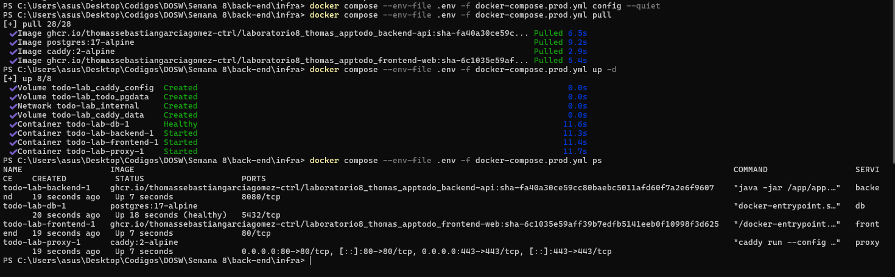

De igual forma para verificar que todo salio de manera adecuada, podemos ver desde docker que se creo una nueva imagen que esta asociada a nuestro proyecto.

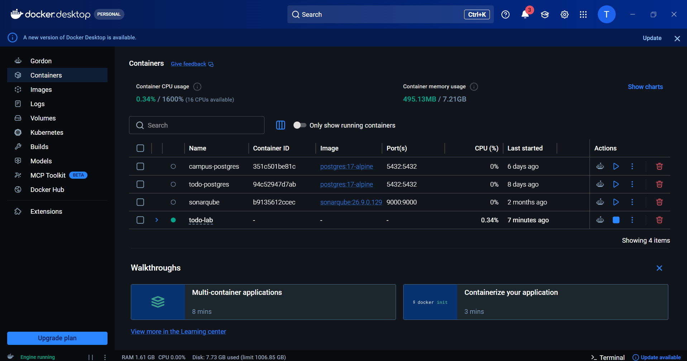

## Parte 10 Etapa C1. Preparar Azure for Students:

Despues de creada la maquina virtual, configurada y con los permisos y los codigos mostrados, dentro de este repositorio vamos a crear el archivo deploy-azure.yml, donde el codigo dado es el siguiente.

```yml
name: CD - Azure VM

on:
  workflow_dispatch:

permissions:
  contents: read
  packages: write

concurrency:
  group: deploy-azure-todo
  cancel-in-progress: false

jobs:
  quality-gate:
    name: Revalidar calidad antes del despliegue
    uses: ./.github/workflows/ci-quality.yml

  deploy-azure:
    name: Desplegar contenedores en Azure
    if: github.ref == 'refs/heads/main'
    needs: quality-gate
    runs-on: [self-hosted, linux, x64, azure-todo]
    environment: azure-lab
    timeout-minutes: 20
    steps:
      - uses: actions/checkout@v4

      - name: Preparar configuración y desplegar
        shell: bash
        env:
          GHCR_TOKEN: ${{ secrets.GITHUB_TOKEN }}
          DB_PASSWORD: ${{ secrets.AZURE_DB_PASSWORD }}
          JWT_SECRET: ${{ secrets.AZURE_JWT_SECRET }}
          TODO_DOMAIN: ${{ vars.AZURE_DOMAIN }}
        run: |
          set -euo pipefail
          : "${DB_PASSWORD:?Configurar AZURE_DB_PASSWORD}"
          : "${JWT_SECRET:?Configurar AZURE_JWT_SECRET}"
          : "${TODO_DOMAIN:?Configurar variable AZURE_DOMAIN}"

          # Variables que espera el docker-compose.prod.yml
          export API_IMAGE="ghcr.io/thomassebastiangarciagomez-ctrl/laboratorio8_thomas_apptodo_backend-api"
          export WEB_IMAGE="ghcr.io/thomassebastiangarciagomez-ctrl/laboratorio8_thomas_apptodo_frontend-web"
          export BACKEND_TAG="sha-${GITHUB_SHA}"
          export WEB_TAG="sha-6c1035e59aff39b7edfb5141eeb0f10998f3d625"

          DEPLOY_DIR="$HOME/todo-azure"
          COMPOSE="docker compose --env-file $DEPLOY_DIR/.env -f $DEPLOY_DIR/docker-compose.prod.yml"

          mkdir -p "$DEPLOY_DIR/db"
          cp infra/docker-compose.prod.yml "$DEPLOY_DIR/docker-compose.prod.yml"
          cp infra/Caddyfile "$DEPLOY_DIR/Caddyfile"
          cp -a infra/db/. "$DEPLOY_DIR/db/"

          umask 077
          {
            printf 'API_IMAGE=%s\n' "$API_IMAGE"
            printf 'WEB_IMAGE=%s\n' "$WEB_IMAGE"
            printf 'BACKEND_TAG=%s\n' "$BACKEND_TAG"
            printf 'WEB_TAG=%s\n' "$WEB_TAG"
            printf 'TODO_DOMAIN=%s\n' "$TODO_DOMAIN"
            printf 'DB_PASSWORD=%s\n' "$DB_PASSWORD"
            printf 'JWT_SECRET=%s\n' "$JWT_SECRET"
          } > "$DEPLOY_DIR/.env"

          echo "$GHCR_TOKEN" | docker login ghcr.io -u "$GITHUB_ACTOR" --password-stdin
          $COMPOSE config --quiet
          $COMPOSE pull
          $COMPOSE up -d --remove-orphans
          docker logout ghcr.io

          echo "Verificando HTTPS y estado de la aplicación..."

          # 1) /health por HTTPS con certificado válido (sin -k ni --resolve)
          ok=0
          for attempt in $(seq 1 36); do
            if curl --fail --silent --show-error "https://${TODO_DOMAIN}/health" >/dev/null; then
              ok=1
              break
            fi
            sleep 5
          done
          if [ "$ok" -ne 1 ]; then
            echo 'Error: /health no respondió correctamente'
            $COMPOSE ps
            $COMPOSE logs --tail=40 proxy
            exit 1
          fi
          echo "/health OK"

          # 2) La API protegida debe rechazar la petición sin JWT (401).
          #    Se reintenta porque el backend puede tardar en arrancar (502/503 al inicio).
          code=000
          for attempt in $(seq 1 36); do
            code=$(curl --silent --output /dev/null --write-out '%{http_code}' "https://${TODO_DOMAIN}/api/v1/tasks" || true)
            if [ "$code" = "401" ]; then
              break
            fi
            sleep 5
          done
          if [ "$code" != "401" ]; then
            echo "API sin token devolvió HTTP $code (se esperaba 401). Revisar Spring Security o el backend."
            $COMPOSE ps
            $COMPOSE logs --tail=60 backend
            exit 1
          fi

          echo "Azure: despliegue, HTTPS y protección básica verificados"
```

Algo mas a tener en cuenta, es que previamente se tuvieron que configurar las variables secretas correspondientes dentro del repositorio en github, en este caso, el el repositorio de backend.

Aqui se presentan las imagenes asociadas al despliegue en Azure, donde se logra evidenciar que efectivamente todo funciona de manera correcta.

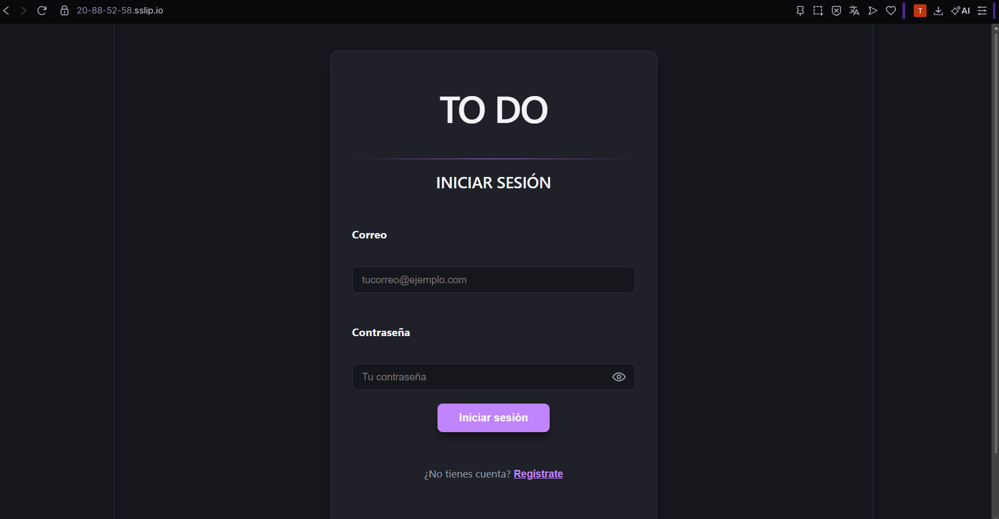


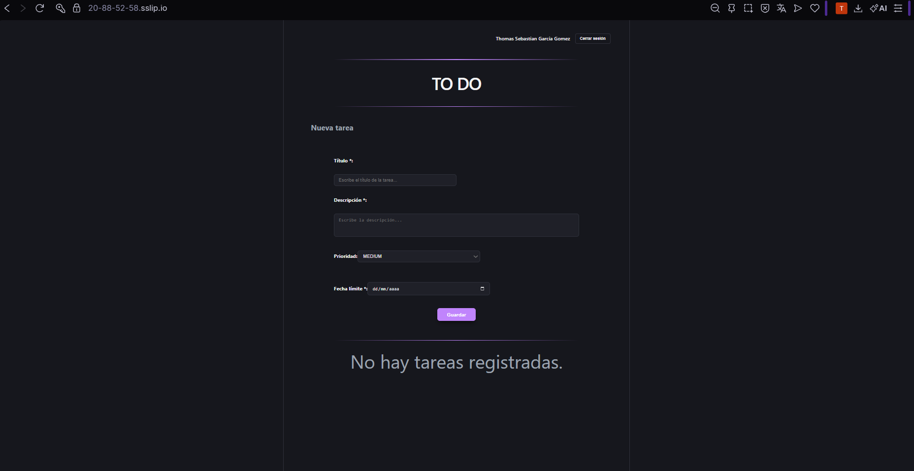


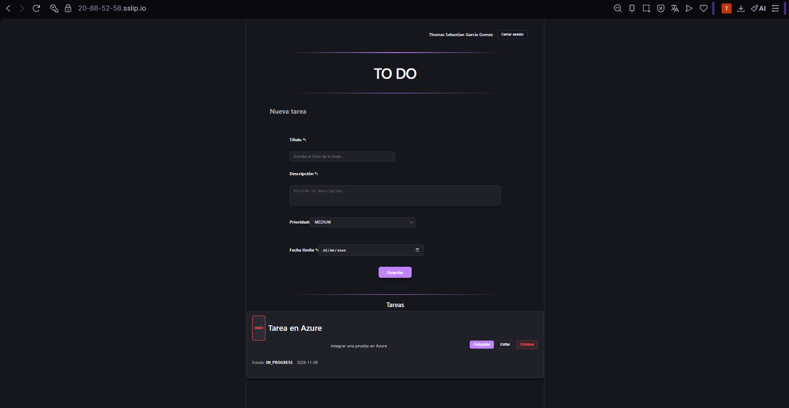


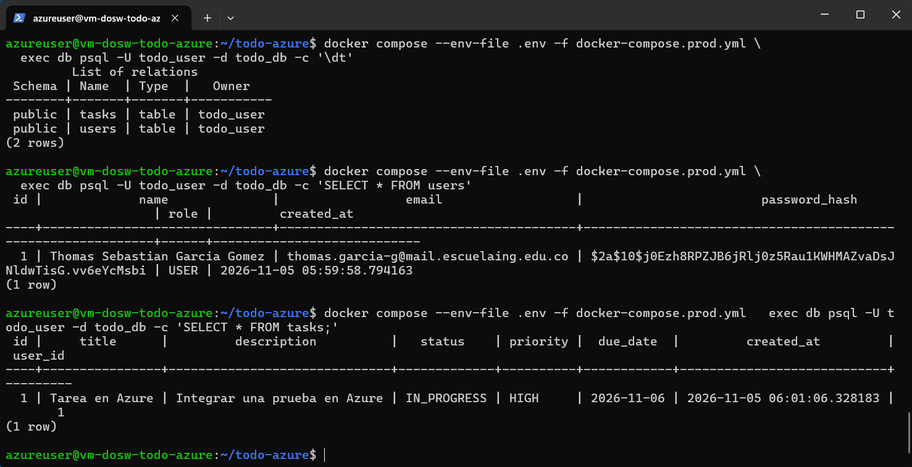

En la siguiente imagen, se comprueba que la maquina virtual creada, esta configurada de manera adecuada, lo que indica que esta funcionando para realizar de manera adecuada CD.

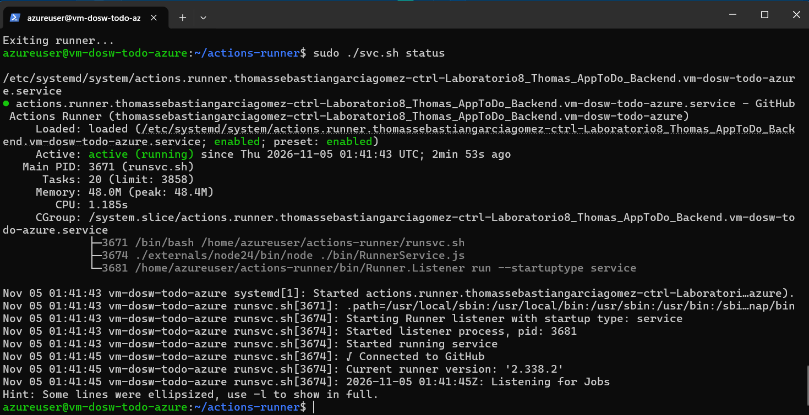

Como se puede evidenciar en la imagen, se logra ver que la configuracion en docker y que la maquina este corriendo en segundo plano la imagen es la esperada.

## Parte 15 Etapa D1. Preparar el entorno AWS Academy Learner Lab:

Para esta parte, tenemos que realizar varias cosas, al igual que con Azure, en AWS vamos a crear una maquina virtual en EC2, debemos crear el runner correspondiente y cuando ya este configurado esto vamos a crear el ambiente, cabe recalcar, que para este se utilizo como dominio 52-45-205-228.sslip.io, esto gracias a Caddy, el cual no permite el acceso directamente usando la IP, por ende, se utiliza este dominio de resolucion DNS rapida como dominio. Esto tambien se implemento en Azure.

Con la instancia creada y con las configuraciones de IP estatica (en AWS las maquinas en EC2 tienen IP dinamica inicialmente), junto con las internas logramos ver lo siguiente.

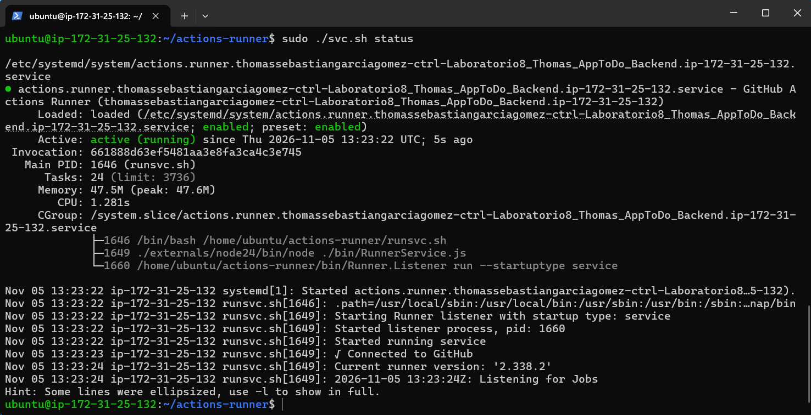

Al realizar esto, ahora vamos a incluir el .yml correspondiente a AWS, de tal forma que ahora, tenemos que es el mismo que se utiliza dentro de Azure, pero con las variables cambiadas.

```yml
name: CD - AWS Academy EC2

on:
  workflow_dispatch:

permissions:
  contents: read
  packages: write

concurrency:
  group: deploy-aws-todo
  cancel-in-progress: false

jobs:
  quality-gate:
    name: Revalidar calidad antes del despliegue
    uses: ./.github/workflows/ci-quality.yml

  deploy-aws:
    name: Desplegar contenedores en EC2
    if: github.ref == 'refs/heads/main'
    needs: quality-gate
    runs-on: [self-hosted, linux, x64, aws-todo]
    environment: aws-lab
    timeout-minutes: 20
    steps:
      - uses: actions/checkout@v4

      - name: Preparar configuración y desplegar
        shell: bash
        env:
          GHCR_TOKEN: ${{ secrets.GITHUB_TOKEN }}
          DB_PASSWORD: ${{ secrets.AWS_DB_PASSWORD }}
          JWT_SECRET: ${{ secrets.AWS_JWT_SECRET }}
          TODO_DOMAIN: ${{ vars.AWS_DOMAIN }}
        run: |
          set -euo pipefail
          : "${DB_PASSWORD:?Configurar AWS_DB_PASSWORD}"
          : "${JWT_SECRET:?Configurar AWS_JWT_SECRET}"
          : "${TODO_DOMAIN:?Configurar variable AWS_DOMAIN}"

          export API_IMAGE="ghcr.io/thomassebastiangarciagomez-ctrl/laboratorio8_thomas_apptodo_backend-api"
          export WEB_IMAGE="ghcr.io/thomassebastiangarciagomez-ctrl/laboratorio8_thomas_apptodo_frontend-web"
          export BACKEND_TAG="sha-${GITHUB_SHA}"
          export WEB_TAG="sha-6c1035e59aff39b7edfb5141eeb0f10998f3d625"

          DEPLOY_DIR="$HOME/todo-aws"
          COMPOSE="docker compose --env-file $DEPLOY_DIR/.env -f $DEPLOY_DIR/docker-compose.prod.yml"

          mkdir -p "$DEPLOY_DIR/db"
          cp infra/docker-compose.prod.yml "$DEPLOY_DIR/docker-compose.prod.yml"
          cp infra/Caddyfile "$DEPLOY_DIR/Caddyfile"
          cp -a infra/db/. "$DEPLOY_DIR/db/"

          umask 077
          {
            printf 'API_IMAGE=%s\n' "$API_IMAGE"
            printf 'WEB_IMAGE=%s\n' "$WEB_IMAGE"
            printf 'BACKEND_TAG=%s\n' "$BACKEND_TAG"
            printf 'WEB_TAG=%s\n' "$WEB_TAG"
            printf 'TODO_DOMAIN=%s\n' "$TODO_DOMAIN"
            printf 'DB_PASSWORD=%s\n' "$DB_PASSWORD"
            printf 'JWT_SECRET=%s\n' "$JWT_SECRET"
          } > "$DEPLOY_DIR/.env"

          echo "$GHCR_TOKEN" | docker login ghcr.io -u "$GITHUB_ACTOR" --password-stdin
          $COMPOSE config --quiet
          $COMPOSE pull
          $COMPOSE up -d --remove-orphans
          docker logout ghcr.io

          echo "Verificando HTTPS y estado de la aplicación..."

          ok=0
          for attempt in $(seq 1 36); do
            if curl --fail --silent --show-error "https://${TODO_DOMAIN}/health" >/dev/null; then
              ok=1
              break
            fi
            sleep 5
          done
          if [ "$ok" -ne 1 ]; then
            echo 'Error: /health no respondió correctamente'
            $COMPOSE ps
            $COMPOSE logs --tail=40 proxy
            exit 1
          fi
          echo "/health OK"

          code=000
          for attempt in $(seq 1 36); do
            code=$(curl --silent --output /dev/null --write-out '%{http_code}' "https://${TODO_DOMAIN}/api/v1/tasks" || true)
            if [ "$code" = "401" ]; then
              break
            fi
            sleep 5
          done
          if [ "$code" != "401" ]; then
            echo "API sin token devolvió HTTP $code (se esperaba 401). Revisar Spring Security o el backend."
            $COMPOSE ps
            $COMPOSE logs --tail=60 backend
            exit 1
          fi

          echo "AWS Academy: despliegue, HTTPS y protección básica verificados"
```

Ahora, al realizar estos cambios e integraciones, se va a mostrar el funcionamiento de la aplicacion en AWS, de tal forma que el despliegue es el esperado.

